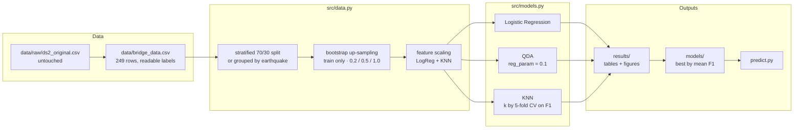
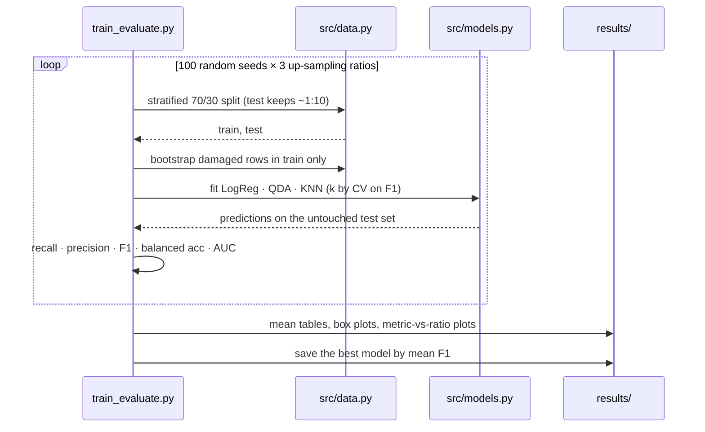

# Predicting Bridge Performance under Earthquakes

<p align="center">
  <a href="Earthquake-Bridge-Performance%20Demo.mp4">
    
  </a>
  <br>
  <sub>▶ <b><a href="Earthquake-Bridge-Performance%20Demo.mp4">Watch the Earthquake-Bridge-Performance demo</a></b> (90 s): the README quick start on a fresh clone with all four experiments re-run (every README table matches), then the review deck and the demo CLI, checked against the data</sub>
</p>

**Will this bridge be damaged? Age, magnitude and distance to the epicentre — and an honest test on earthquakes the model has never seen.**

[](requirements.txt)
[](src/models.py)
[](data/bridge_data.csv)
[](sources/)
[](LICENSE)

A Machine Learning mini-project (UE24CS352A). Given a bridge's **age**, the
earthquake's **magnitude** and the **distance to the epicentre**, predict whether
the bridge was **damaged (1)** or **undamaged (0)**. An extension adds material
and bridge type and predicts the damage level.

It reproduces and corrects a Stanford CS229 report on the same data: resampling
after the split, metrics that survive an 8% positive rate, and a split grouped
by earthquake so the model cannot simply remember an event.

---

## Contents

| Section | |
|---|---|
| [What it does](#what-it-does) | The experiments, by area |
| [Pipeline](#pipeline) | How the pieces fit |
| [How an experiment runs](#how-an-experiment-runs) | Split, resample, fit, score, repeat |
| [Quick start](#quick-start) | Install, run, predict |
| [Results](#results) | Binary, multi-class, and grouped by earthquake |
| [Design decisions](#design-decisions) | What changed from the reference report, and why |
| [Limitations](#limitations) | What the numbers cannot tell you |
| [Repository layout](#repository-layout) | Where things live |
| [Documentation](#documentation) | Which file answers which question |
| [Team](#team) | Who built it |

---

## What it does

| Area | Capabilities |
|---|---|
| **Binary task** | Damaged / undamaged from core features (age, magnitude, distance) or all features (+ material, bridge type) |
| **Models** | Logistic Regression, regularised QDA, and KNN with k chosen by cross-validated F1 |
| **Imbalance** | Bootstrap up-sampling of damaged examples on the training set only, at three target ratios |
| **Evaluation** | 100 random stratified splits × 3 ratios; recall, precision, F1, balanced accuracy, ROC-AUC |
| **Extension** | Multi-class damage level: none, moderate/severe, partial/full collapse |
| **Leakage check** | Train/test split grouped by earthquake, so no event is in both |
| **Demo** | `predict.py` CLI over the best model by mean F1 |

### Dataset

249 bridge/earthquake pairs, **21 damaged (8.4%)**. Columns: bridge name,
earthquake, material (steel/concrete), bridge type (beam/girder, truss, cable,
arch), age, magnitude, distance to epicentre (miles), damaged (0/1), and damage
level (1 none; 2 moderate/severe, 11 records; 3 partial/full collapse, 10
records). Damaged examples come from government reports of historic
earthquakes; undamaged examples are other USGS-catalogued earthquakes near the
same bridges, assuming "no recorded damage = undamaged".

Source: Jiang & Zhang, *Predicting Bridge Performance under Earthquakes with
Supervised Learning* (Stanford CS229, 2018),
[jzy95310/CS229-Fall-2018-Final-Report](https://github.com/jzy95310/CS229-Fall-2018-Final-Report)
(`Data/ds2.csv`, cleaned and re-labelled with readable category names). All 249
rows were checked against the original row by row.

---

## Pipeline



---

## How an experiment runs



Resampling **after** the split is the point: resampling first would leak
duplicate positives into the test set.

---

## Quick start

```bash
# 1 — environment
python -m venv venv && source venv/bin/activate   # Windows: venv\Scripts\activate
pip install -r requirements.txt

# 2 — experiments (~1 min each; add --runs 20 for a quick check)
python train_evaluate.py --features core   # age, magnitude, distance (as in the report)
python train_evaluate.py --features all    # + material and bridge type
python train_multiclass.py                 # extension: damage level 1/2/3
python grouped_split.py                    # test on earthquakes the model has never seen

# 3 — the live demo
python predict.py --age 53 --mag 6.9 --dist 60
python predict.py --age 53 --mag 6.9 --dist 60 --material steel --type beam_girder
```

Outputs go to `results/` (tables, plots) and `models/` (the best model by mean
F1, used by `predict.py`).

---

## Results

Held-out test sets, mean of 100 runs × 3 ratios.

### Binary, core features (age, magnitude, distance)

| Model | Test acc | Balanced acc | Recall (damaged) | Precision | F1 | AUC |
|---|---:|---:|---:|---:|---:|---:|
| LogReg | 0.972 | 0.942 | **0.906** | 0.803 | **0.841** | **0.994** |
| QDA | 0.969 | 0.925 | 0.873 | 0.793 | 0.819 | 0.992 |
| KNN | 0.973 | 0.896 | 0.804 | 0.874 | 0.821 | 0.906 |

### Binary, all features (+ material, bridge type)

| Model | Test acc | Balanced acc | Recall (damaged) | Precision | F1 | AUC |
|---|---:|---:|---:|---:|---:|---:|
| LogReg | 0.974 | 0.934 | 0.886 | 0.833 | 0.849 | 0.988 |
| QDA | 0.968 | 0.906 | 0.833 | 0.802 | 0.803 | 0.986 |
| KNN | 0.955 | 0.800 | 0.616 | 0.801 | 0.672 | 0.803 |

Material and bridge type give no clear gain for Logistic Regression (F1 up
slightly, AUC down slightly) and hurt KNN, possibly because binary features
distort distances when there are so few positives (not tested). For Logistic
Regression and QDA, higher up-sampling ratios raise recall but lower precision;
KNN improves on both.

### Multi-class damage level

All features, minority levels bootstrapped up to the majority count; KNN uses a
fixed k = 3.

| Model | Accuracy | Macro-F1 | Recall L1 | Recall L2 | Recall L3 |
|---|---:|---:|---:|---:|---:|
| LogReg | 0.936 | 0.662 | 0.966 | 0.630 | 0.550 |
| QDA | 0.927 | 0.622 | 0.962 | 0.553 | 0.513 |
| KNN | 0.923 | 0.554 | 0.971 | 0.357 | 0.380 |

With only 11 and 10 examples in levels 2 and 3, these numbers are noisy.

### Testing on unseen earthquakes

All 21 damaged rows come from just 7 earthquakes (Alaska 1964, San Fernando
1971, Miyagi 1978, Loma Prieta 1989, Northridge 1994, Kobe 1995, Tohoku 2011).
A random split can train on one Northridge row and test on another, which mostly
checks whether the model remembers magnitude 6.7. `grouped_split.py` holds out
2 of the 7 damaging earthquakes and 30% of the other events per run, so no event
is in both sets. Misspelt event names are normalised first; up-sampling ratio
0.5.

| Model | Split | Test acc | Balanced acc | Recall (damaged) | Precision | F1 | AUC |
|---|---|---:|---:|---:|---:|---:|---:|
| LogReg | random | 0.972 | 0.939 | 0.898 | 0.807 | 0.840 | 0.994 |
| LogReg | grouped | 0.948 | 0.932 | 0.911 | 0.724 | 0.762 | 0.990 |
| QDA | random | 0.968 | 0.926 | 0.875 | 0.781 | 0.816 | 0.993 |
| QDA | grouped | 0.964 | 0.920 | 0.867 | 0.794 | **0.800** | 0.994 |
| KNN | random | 0.974 | 0.898 | 0.808 | 0.880 | 0.828 | 0.901 |
| KNN | grouped | 0.932 | 0.804 | 0.637 | 0.739 | 0.620 | 0.814 |

KNN loses the most, which fits the idea that it was partly matching rows from
the same event. Logistic Regression keeps its recall and AUC but raises more
false alarms. **QDA barely changes and is the best model on this stricter test**,
which agrees with the reference report's choice.

### Against the reference report

| Model | Report test acc | Report acc on damaged | Our test acc | Our recall on damaged |
|---|---:|---:|---:|---:|
| LogReg | 0.738 | 0.827 | 0.972 | 0.906 |
| QDA | 0.948 | 0.995 | 0.969 | 0.873 |
| KNN | 0.806 | 0.299 | 0.973 | 0.804 |

The report picks k = 2 for KNN by accuracy; picking k by F1 on scaled features
is the likely reason KNN does much better on the damaged class here. The report
does not say whether it resampled before or after splitting, so the gap for
Logistic Regression cannot be fully explained.

---

## Design decisions

**Split first, then resample.** A stratified 70/30 split keeps the true ~1:10
ratio in the test set. Bootstrap up-sampling touches the training set only;
doing it before the split would put copies of the same positive on both sides.

**Accuracy is not the metric.** With 8% positives, always predicting "undamaged"
scores ~92%. Every table reports recall, precision, F1, balanced accuracy and
ROC-AUC, averaged over 100 splits.

**Scale before distance-based models.** Distance and magnitude live on very
different scales, so Logistic Regression and KNN see standardised features.

**Regularise QDA.** About 15 positives per training split cannot estimate a full
covariance matrix, so QDA uses `reg_param = 0.1`.

**Choose k by F1, not accuracy.** 5-fold cross-validation on F1 picks the KNN
neighbourhood that finds damaged bridges, not the one that ignores them.

**Group by earthquake.** The random split overstates performance because events
repeat across rows. The grouped split measures how much.

---

## Limitations

> [!WARNING]
> - Only **21 positives**, so results vary a lot between splits.
> - Negatives rest on the **"no report = no damage"** assumption, which may be wrong.
> - Positives come from famous large earthquakes, so magnitude and distance separate the
>   classes easily (AUC ~0.99). Performance on typical new events would likely be lower.
> - Bootstrap resampling duplicates data; it does not add information.
> - With only 7 damaging events, two held out per run, the grouped numbers still swing a
>   lot from run to run.

---

## Repository layout

```
.
├── data/
│   ├── bridge_data.csv        249 records, all columns from the source table
│   └── raw/ds2_original.csv   untouched copy of ds2.csv from the reference repo
├── src/
│   ├── data.py                loading, stratified split, bootstrap up-sampling
│   └── models.py              model factories + CV selection of k
├── train_evaluate.py          binary experiment (damaged / undamaged)
├── train_multiclass.py        extension: damage level 1/2/3
├── grouped_split.py           train/test split grouped by earthquake
├── predict.py                 CLI for the live demo
├── results/                   generated metrics and figures
├── models/                    saved best models (core, all)
├── sources/                   reference paper, poster and assignment guidelines
└── docs/                      write-up (PDF) and review slides
```

---

## Documentation

| Question | File |
|---|---|
| *What did we find, in full?* | [docs/writeup.pdf](docs/writeup.pdf) |
| *What was presented at review?* | [docs/slides.pdf](docs/slides.pdf) |
| *Core-feature and all-feature tables* | [results/summary_core.md](results/summary_core.md) · [results/summary_all.md](results/summary_all.md) |
| *Grouped vs random split* | [results/grouped_vs_random_core.md](results/grouped_vs_random_core.md) |
| *Damage-level extension* | [results/multiclass_summary_all.md](results/multiclass_summary_all.md) |
| *What did the reference report do?* | [sources/Report.pdf](sources/Report.pdf) · [sources/Poster.pdf](sources/Poster.pdf) |
| *What did the assignment ask for?* | [sources/](sources/) |

---

## Team

UE24CS352A, Section C, Team 3, Problem statement #27.

| Member | SRN |
|---|---|
| **Guru R Bharadwaj** | PES1UG24CS177 |
| **Chukkapalli Rohan** | PES1UG24CS135 |

---

## License

[MIT](LICENSE).
